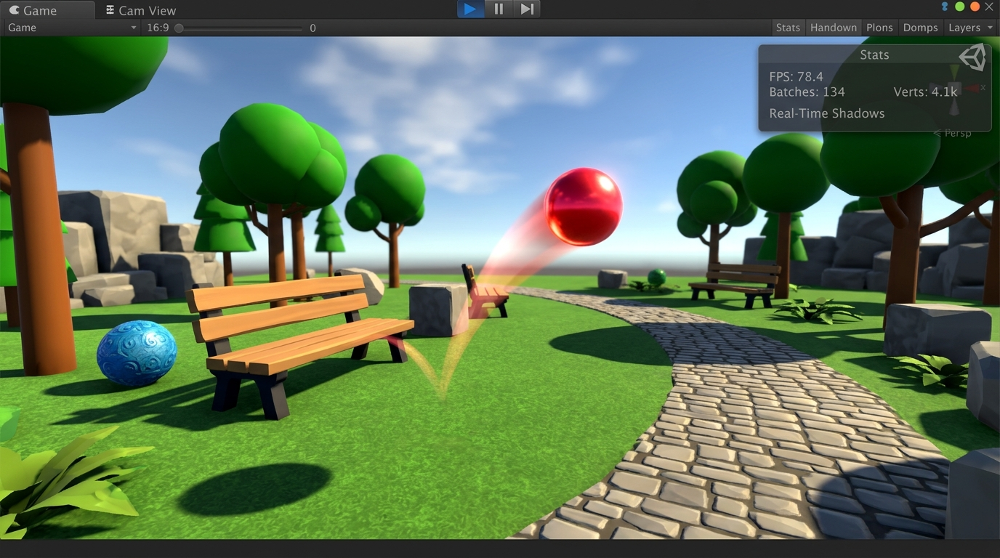

# Playground Physics Project ?" Unity 3D Environment
**Student ID:** 62506  
**Name:** M. Usman Ali  
**Class / Section:** CS-51  

---

## Project Overview
This repository contains the 3D Playground / Park Physics environment in Unity demonstrating basic physics using Rigidbody, Collider, and Physics Material components.

### Requirements Satisfied:
- 1 Plane (ParkGround)
- 3+ Cubes (BenchCube_1, BenchCube_2, ParkBlock_3)
- 2 Spheres (BouncingSphere, DecorativeSphere)
- 1 Cylinder (TreeTrunk)
- 2+ Rigidbody components
- Colliders on all objects
- BouncyMaterial physics material
- Complete scene and camera positioning

---

## Scene Screenshot

